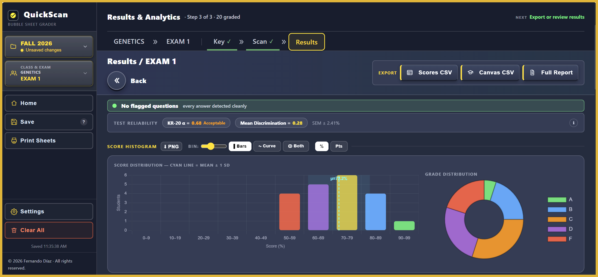
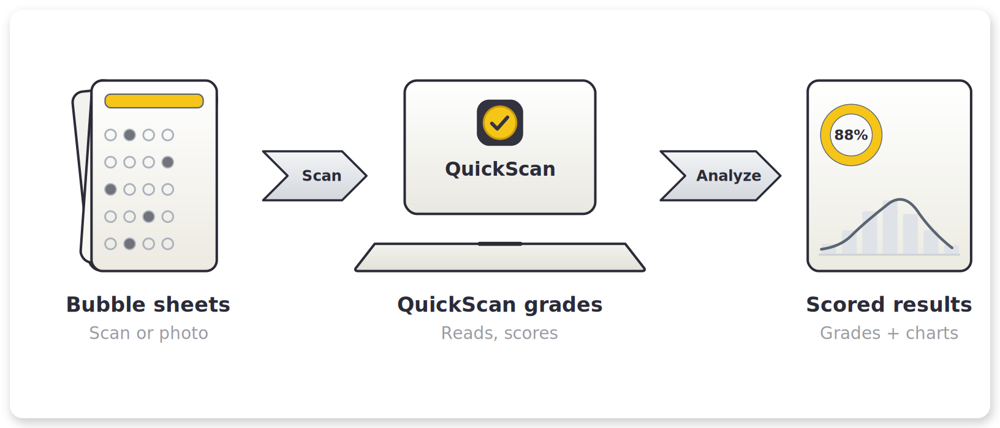
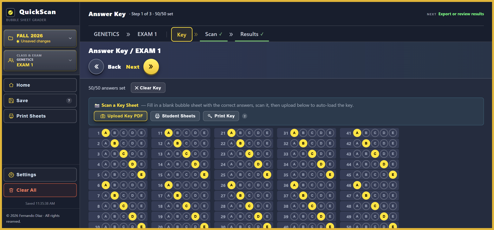
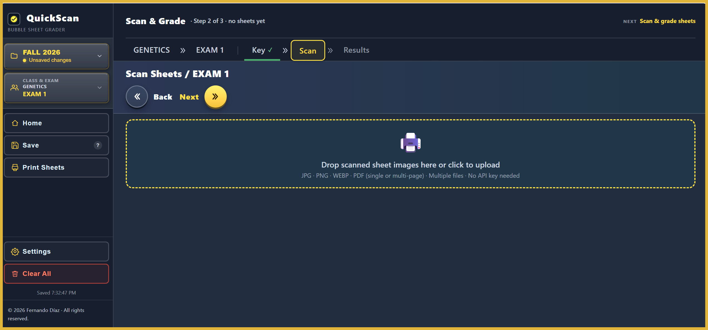
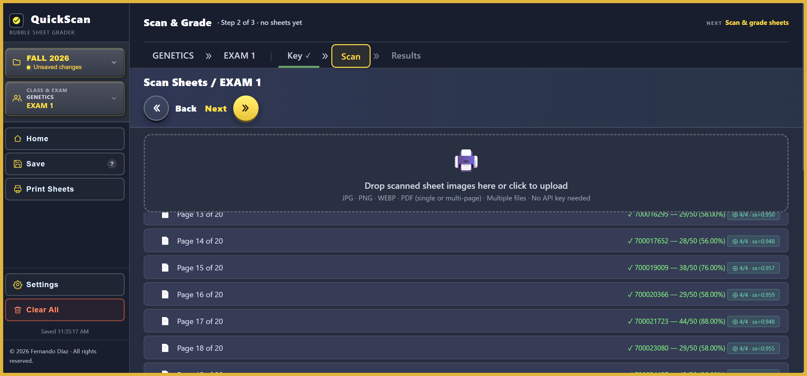
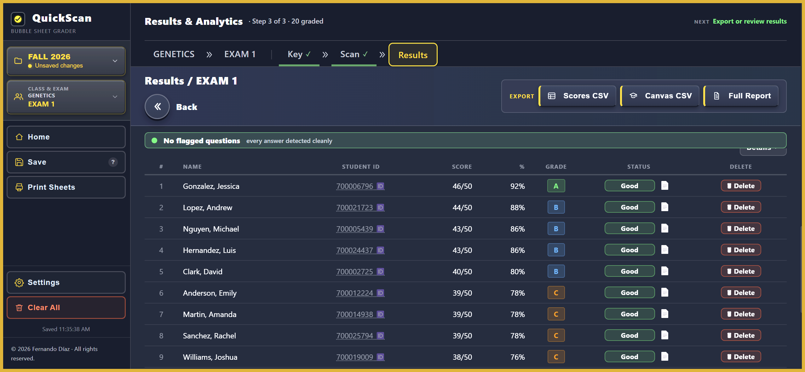

# QuickScan

**Automatically grades bubble-sheet exams. Faster than a Scantron machine, installs like an app, and works with no internet.**

 

[Download a portable copy](https://github.com/ferdiazfer/quickscan/releases/latest/download/QuickScan.html) · [Sample exams](samples/) · [License](LICENSE)

---

## What's new in v2.218

- **Select-all-that-apply questions.** A question can have 2 to 4 correct answers. Fill those bubbles on the key sheet and QuickScan finds them and asks once; or click several letters when you type the key. Grade all or nothing, or turn on partial credit.
- **Question points and bonus questions.** Give any question its own points (two decimals), or set the exam's total and let the other questions share the rest. Bonus questions add points when correct and cost nothing when wrong or blank.
- **One final score everywhere.** Points, percent and grade in the table, the Full Report and both CSV exports are the final score: points and bonus, then the curve, then the 100% cap. An **Adjusted** tag next to the table lists what was applied.
- **Clearer curve wording.** "Add percent to all (+N %)" says what it does.
- **Re-scanning a sheet** grades the new scan with the exam's current settings.
- **Install button** inside the app, plus a hint for iPhone and iPad.

Try the new features with the ready-made set in [`samples/multiple-answers/`](samples/multiple-answers/).

---

## How it works

Scan your students' bubble sheets, QuickScan reads and grades them, and you get scored results with class analytics in seconds.

QuickScan runs entirely in your browser. There is no account, no server, no upload of student data anywhere, and no internet required once it is installed. It grades faster than a Scantron machine and adds class-level analytics a Scantron never gave you.

---

## Step by step

**0. Print the bubble sheets**
Open **Print Sheets**, set the number of questions, and print blank sheets for your students (and one to fill in as the key).

**1. Set the answer key**
Type the key, or scan a filled key sheet and QuickScan reads it. For a select-all-that-apply question, fill (or click) every correct letter.

**2. Drop in your scanned sheets**
Scan or photograph the bubble sheets and drop them in. They grade automatically.

**3. Grade**
Every sheet is scored as it comes in, with the student ID read straight off the page.

**4. Review results**
A ranked score table, exportable to CSV or straight to your Canvas gradebook. Set question points, bonus questions or a curve here; every score updates.

---

## What you get

**Grading**
- Grades a full class of bubble sheets in seconds, from a scan or a phone photo
- Reads the student ID off each sheet automatically
- Select-all-that-apply questions, all or nothing or with partial credit
- Question points, an optional exam total, and bonus questions
- Drop or credit a question, and curve the class, with every score updated at once

**Analysis**
- Class analytics: score histogram, grade distribution, and per-question item analysis
- Test-reliability stats for those who want the detail (KR-20, Cronbach's alpha, item discrimination, distractor analysis)

**Outputs**
- **Canvas CSV**: imports straight into your Canvas gradebook
- Scores CSV with the full breakdown, and a printable Full Report

**Privacy**
- Installs like an app and works fully offline, with no account and no student data leaving your computer

---

## Install

Open the [live app](https://ferdiazfer.github.io/quickscan/) and click **Install** (or your browser's install option). After that it runs offline like any installed app. On iPhone and iPad, use Share, then Add to Home Screen.

Prefer a single file? [Download a portable copy](https://github.com/ferdiazfer/quickscan/releases/latest/download/QuickScan.html): it opens in any browser and runs fully offline, with no install step.

To try it right now with no printer or scanner, grade a ready-made set in [`samples/`](samples/): the basic set (one answer key plus 20 filled student sheets) or the [multiple-answers set](samples/multiple-answers/).

---

## License

QuickScan is source-available software, not open source. See [LICENSE](LICENSE) for terms.

© 2026 Fernando Díaz. QuickScan is independent and unaffiliated; Scantron is a trademark of Scantron Corporation, referenced here only for comparison.
